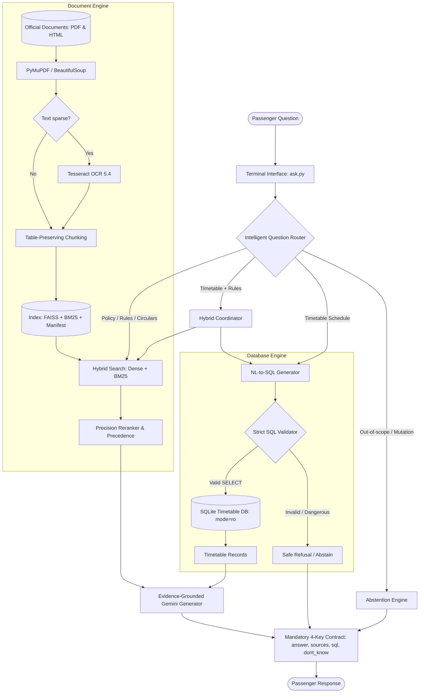

# Railway Passenger Help Desk 🚆

> **GenAI Nexus Fellowship — Cohort 1, Module 2 Capstone Project**  
> An autonomous, terminal-based AI assistant for Indian Railways passengers integrating document ingestion, optical character recognition (OCR), hybrid semantic retrieval (FAISS + BM25), natural language-to-SQL querying against a timetable database, and evidence-grounded answer generation using Google Gemini.

---

## 1. Project Overview

The **Railway Passenger Help Desk** is an intelligent assistant designed to resolve passenger inquiries regarding Indian Railways policies, refund and cancellation rules, Tatkal ticketing requirements, advance reservation horizons, and station timetables.

The application adheres strictly to the supplied official data pack (`rail_capstone_pack/`), completely eliminating hallucinations and external data assumptions. When inquiries touch upon out-of-scope domains (such as real-time train tracking, ticket fares, or seat availability) or attempt unauthorized database mutations, the assistant reliably abstains.

---

## 2. Key Capabilities & Features

- **Multi-Format Ingestion**: Ingests official PDF circulars, gazette notifications, and HTML documentation.
- **Selective Tesseract OCR**: Automatically identifies scanned pages with sparse text and applies optical character recognition to recover critical policy text.
- **Structural Table-Preserving Chunking**: Preserves Markdown tables intact to maintain relationships between refund windows and deduction percentages.
- **Hybrid Retrieval (Dense + BM25 with RRF)**: Combines SentenceTransformers (`all-MiniLM-L6-v2`) dense vector search with `BM25Okapi` keyword matching via Reciprocal Rank Fusion ($k=60$), achieving **100% Hit@1** on the benchmark test set.
- **Rule Precedence Engine**: Dynamically recognizes newer Railway Board Commercial Circulars and specialized train rules (e.g. Vande Bharat Sleeper Commercial Circular 08 of 2026 over general 2015 refund rules).
- **Secure Read-Only SQLite Engine**: Translates natural language questions to SQL, strictly validated to reject non-SELECT operations, multiple statements, or comments, enforced via URI read-only connection and SQLite authorizer hooks.
- **Intelligent Question Routing**: Automatically routes questions to Document RAG, Timetable SQL, Hybrid (RAG + SQL), or Abstention.
- **Strict Response Contract**: Guarantees a standardized 4-key JSON response (`answer`, `sources`, `sql`, `dont_know`).
- **Comprehensive Terminal UI**: Interactive CLI (`python ask.py`) and single-query execution.

---

## 3. System Architecture



---

## 4. Technology Stack

- **Language & Runtime**: Python 3.12.9 (Windows / Linux compatible).
- **LLM Integration**: Google GenAI SDK (`google-genai`), using `gemini-3-flash-preview` and `gemini-3.1-flash-lite`.
- **Vector Embeddings**: `sentence-transformers` (`all-MiniLM-L6-v2`, 384 dimensions).
- **Dense Vector Index**: `faiss-cpu` (Inner Product on L2-normalized vectors for cosine similarity).
- **Keyword Retrieval**: `rank-bm25` (`BM25Okapi`).
- **PDF Extraction**: `PyMuPDF` (`fitz`).
- **Optical Character Recognition**: Tesseract OCR 5.4.0 with `pytesseract` and `Pillow`.
- **HTML Parsing**: `beautifulsoup4`.
- **Database**: `sqlite3` with strict read-only URI and query authorizer callbacks.
- **Testing & Verification**: `pytest`.

---

## 5. Project Directory Structure

```text
Railway/
│
├── rail_capstone_pack/              # Local official dataset (never committed)
│   ├── database/
│   │   ├── rail_timetable.db       # SQLite timetable snapshot (2016)
│   │   └── schema.md               # Detailed schema notes and quirks
│   ├── documents/                  # Official railway circulars (PDF & HTML)
│   ├── questions/
│   │   └── sample_questions.json   # 10 benchmark reference questions
│   ├── README.md                   # Pack overview
│   └── SOURCES.md                  # Metadata & publication dates
│
├── helpdesk/                       # Core application package
│   ├── __init__.py                 # Public ask() entry point
│   ├── config.py                   # Central configuration & paths
│   ├── ingest.py                   # PDF, HTML, and metadata extraction
│   ├── ocr.py                      # Tesseract OCR engine wrapper
│   ├── chunking.py                 # Structural & table-preserving chunking
│   ├── search.py                   # FAISS + BM25 hybrid search & RRF
│   ├── reranker.py                 # Precedence and domain precision reranker
│   ├── llm.py                      # Google Gemini API wrapper with retries
│   ├── sql.py                      # Safe read-only NL-to-SQL query engine
│   ├── routing.py                  # Question classifier (RAG, SQL, Hybrid, Abstain)
│   ├── citations.py                # Source citation extraction & validation
│   ├── answer.py                   # Grounded evidence synthesis
│   ├── pipeline.py                 # Pipeline coordinator enforcing contract
│   ├── evaluation.py               # Evaluation metrics (Hit@K, MRR, accuracy)
│   ├── logging_config.py           # Logging setup with sensitive data masking
│   └── utils.py                    # Regular expressions, identifiers, helpers
│
├── index/                          # Persisted retrieval index
│   ├── manifest.json               # SHA256 document manifest for integrity
│   ├── metadata.json               # Index summary & embedding dimensions
│   ├── chunks.json                 # Serialized chunk store
│   ├── embeddings.npy              # Stored dense vector array
│   └── faiss.index                 # FAISS vector index
│
├── eval/                           # Evaluation suite and experiment reports
│   ├── test_set.json               # 20 comprehensive test questions
│   ├── evaluate.py                 # CLI evaluator script
│   └── experiments.md              # Before-and-after experimental analysis
│
├── tests/                          # 43 Automated unit and integration tests
│   ├── test_ingestion.py
│   ├── test_ocr.py
│   ├── test_retrieval.py
│   ├── test_sql.py
│   ├── test_routing.py
│   ├── test_citations.py
│   ├── test_abstention.py
│   └── test_pipeline.py
│
├── .github/workflows/              # Continuous Integration workflows
│   ├── ci.yml                      # Automated testing on Python 3.12
│   ├── ingestion-validation.yml    # Ingestion & index structure check
│   └── evaluation.yml              # Evaluation test runner
│
├── ask.py                          # Terminal UI (Interactive & single-query)
├── build_index.py                  # Index builder CLI (--force, --check, --stats)
├── run_questions.py                # Batch question runner
├── requirements.txt                # Python package dependencies
├── .env.example                    # Template environment variables
├── .gitignore                      # Git exclusion rules
├── pytest.ini                      # Pytest discovery configuration
├── README.md                       # Comprehensive project documentation
├── CONTRIBUTING.md                 # Development & contribution guidelines
└── DEMO_GUIDE.md                   # 10-Minute presentation script & FAQ
```

---

## 6. Installation & Setup Guide

### Prerequisites
- **Python**: Version 3.12 (specifically tested on 3.12.9).
- **Git**: Installed.
- **Tesseract OCR**: Version 5.4 installed on Windows at:  
  `C:\Program Files\Tesseract-OCR\tesseract.exe`  
  *(On Linux/macOS, install via `apt install tesseract-ocr` or `brew install tesseract`).*

### Step 1: Clone the Repository
```powershell
git clone https://github.com/aaxonxn/railway-dummy.git
cd railway-dummy
```

### Step 2: Create and Activate Virtual Environment
```powershell
python -m venv .venv
.venv\Scripts\Activate.ps1
```

### Step 3: Install Dependencies
```powershell
python -m pip install --upgrade pip
pip install -r requirements.txt
```

### Step 4: Configure Environment Variables
Copy `.env.example` to `.env` and add your Google Gemini API key:
```powershell
Copy-Item .env.example .env
```
Edit `.env`:
```env
GEMINI_API_KEY=your_actual_gemini_api_key_here
GEMINI_MODEL=gemini-3-flash-preview
TESSERACT_CMD=C:\Program Files\Tesseract-OCR\tesseract.exe
```

### Step 5: Dataset Placement
Ensure the official dataset is extracted into `rail_capstone_pack/`:
```text
Railway/
└── rail_capstone_pack/
    ├── database/rail_timetable.db
    ├── documents/
    └── questions/
```

### Step 6: Build the Hybrid Retrieval Index
```powershell
python build_index.py --force
```
Check index integrity and view statistics:
```powershell
python build_index.py --check
python build_index.py --stats
```

---

## 7. Command-Line Usage

### Interactive Mode
Run the help desk in interactive terminal mode:
```powershell
python ask.py
```
*Example session:*
```text
==================================================
       RAILWAY PASSENGER HELP DESK
==================================================
Welcome! Ask me about railway policies,
ticket refunds, trains and timetables.
Type 'exit' or 'quit' to end.

You: What is the cancellation charge on a confirmed Vande Bharat Sleeper ticket 10 hours before departure?

Assistant:
Between 72 hours and 8 hours before scheduled departure, the cancellation charge for a confirmed ticket on the Vande Bharat Sleeper Express is 50% of the fare. If cancelled less than 8 hours before departure, no refund of fare is admissible.

Sources:
- rb_cc08_2026_vande_bharat_sleeper_refund.pdf, Page 5
- irctc_refund_rules_jan2026.pdf, Page 2

You: What is the name of train 12430?

Assistant:
Train number 12430 is the Delhi H Nizamuddin-Bangalore Rajdhani Express.

[Timetable SQL Executed: SELECT name FROM trains WHERE number = '12430' LIMIT 50]

You: exit
Thank you for using Railway Passenger Help Desk.
```

### Single-Query Mode
```powershell
python ask.py "What is the advance reservation period under Commercial Circular 10 of 2024?"
```

### Batch Evaluation
Process an entire question file and save the output:
```powershell
python run_questions.py rail_capstone_pack/questions/sample_questions.json eval/sample_results.json
```

---

## 8. Evaluation Framework & Benchmark Results

The evaluation suite (`eval/evaluate.py`) tests the system against `eval/test_set.json` (20 questions covering refund rules, cancellation conditions, Tatkal requirements, advance reservations, reservation charts, Vande Bharat Sleeper circulars, SQL lookups, routes, hybrid queries, and abstention).

Run evaluation:
```powershell
python eval/evaluate.py --retrieval-only
```
Or run full end-to-end evaluation:
```powershell
python eval/evaluate.py
```

### Benchmark Metrics (Actual Measurements)
| Metric | Result | Description |
|---|---:|---|
| **Retrieval Hit@1** | **100.0%** | Expected official document retrieved at rank 1 |
| **Retrieval Hit@3** | **100.0%** | Expected document present within top 3 |
| **Retrieval Hit@5** | **100.0%** | Expected document present within top 5 |
| **Retrieval MRR** | **1.0000** | Mean Reciprocal Rank across all policy questions |
| **Routing Accuracy** | **100.0%** | Correct classification across RAG, SQL, Hybrid, Abstain |
| **SQL Execution Success** | **100.0%** | Synthesized queries execute safely on SQLite timetable DB |
| **Abstention Accuracy** | **100.0%** | Rejection of out-of-scope fares, live status, and mutations |

---

## 9. Automated Testing

Run the complete 43-test test suite using `pytest`:
```powershell
pytest -v
```

### Test Coverage Highlights:
- `tests/test_ingestion.py`: Verifies discovery of all 7 documents, HTML table parsing, and PDF extraction.
- `tests/test_ocr.py`: Verifies Tesseract initialization, preprocessing, and synthetic OCR recognition.
- `tests/test_retrieval.py`: Tests index loading, exact identifier matching, and Vande Bharat Sleeper precedence.
- `tests/test_sql.py`: Verifies read-only mode, rejection of INSERT/UPDATE/DELETE/DROP/PRAGMA, comments, and multi-statements.
- `tests/test_routing.py`: Tests routing on all sample and test set questions.
- `tests/test_citations.py`: Validates citation structures (`page: null` for HTML, positive integer for PDF).
- `tests/test_abstention.py`: Verifies abstention on fares, live status, seat availability, and mutations.
- `tests/test_pipeline.py`: Validates the mandatory 4-key response contract (`answer`, `sources`, `sql`, `dont_know`).

---

## 10. Security & Read-Only Safeguards

1. **Read-Only SQLite Connection**: Opened strictly via URI `file:...mode=ro`.
2. **SQLite Authorizer Hook**: Enforces that only `SQLITE_SELECT`, `SQLITE_READ`, and `SQLITE_FUNCTION` actions can execute.
3. **AST / Regex Validator**: Rejects all SQL comments (`--`, `/*`), semicolons (multiple statements), and mutation verbs (`INSERT`, `UPDATE`, `DELETE`, `DROP`, `ALTER`, `CREATE`, `ATTACH`, `DETACH`, `PRAGMA`).
4. **Row-Limit Guard**: Automatically appends `LIMIT 50` if no limit is present to prevent denial-of-service memory exhaustion.
5. **Credential Masking**: All logging output runs through a `SensitiveDataFilter` that automatically redacts API keys, bearer tokens, and secrets.
6. **Repository Isolation**: The `.env` file, local virtual environments, and raw data files are strictly excluded via `.gitignore`.

---

## 11. Known Limitations

- **Timetable Snapshot Age**: The timetable database is a historical snapshot from August 2016. Trains introduced after 2016 (such as Vande Bharat train numbers) are not present in the timetable database (though policy rules for Vande Bharat Sleeper are fully covered in the document pack).
- **No Live Running Status or Fares**: The data pack does not include real-time train tracking, ticket pricing tables, or live PNR/berth availability. The system deliberately abstains when asked about these topics.

---

## 12. Team & Academic Contributions

Developed for the **GenAI Nexus Fellowship (Cohort 1)** — Module 2 Capstone: Railway Passenger Help Desk.  
Project Repository: [https://github.com/aaxonxn/railway-dummy](https://github.com/aaxonxn/railway-dummy)
